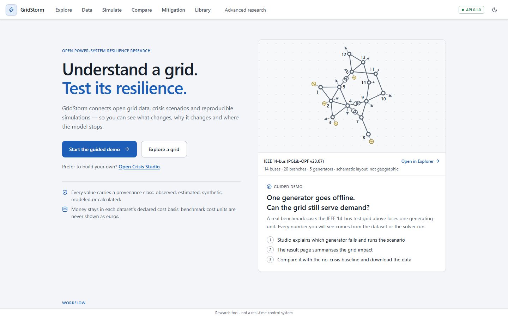
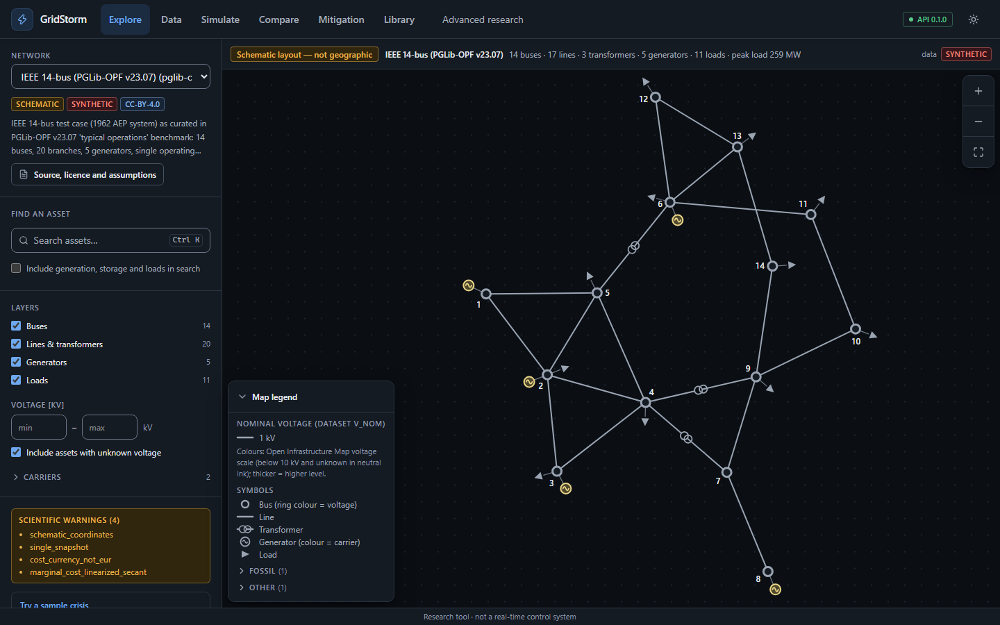
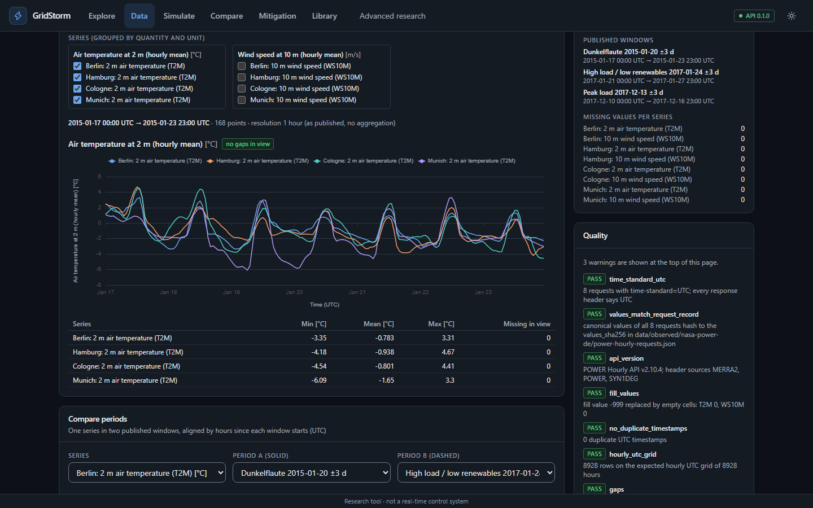
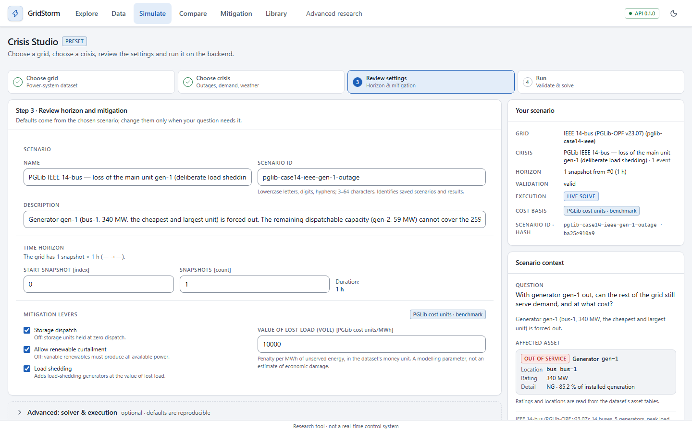
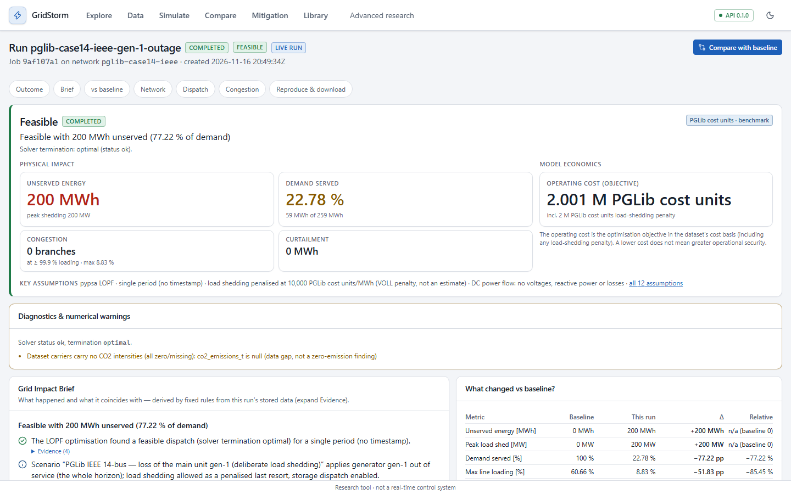
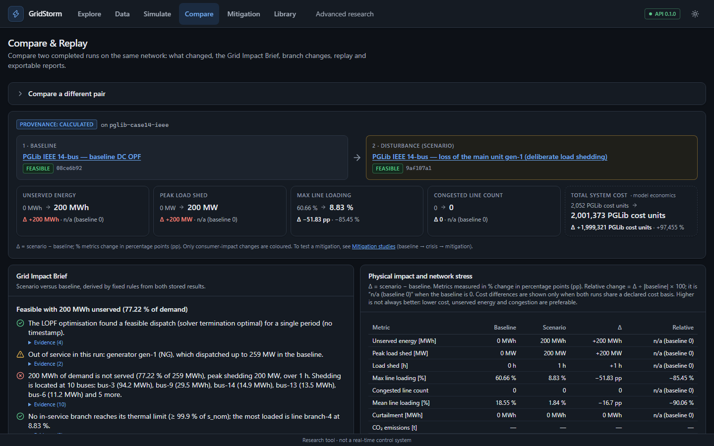
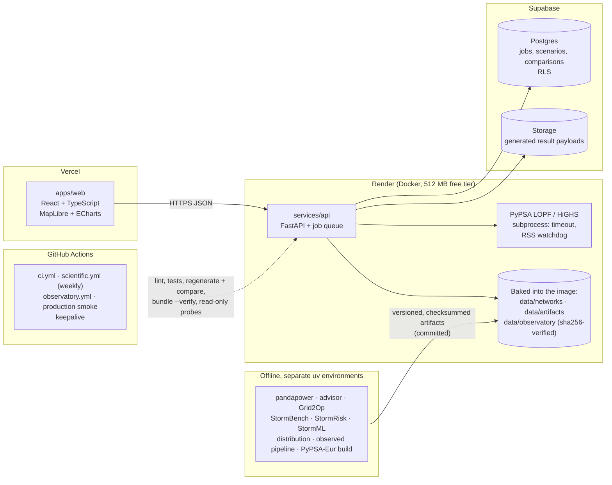

# GridStorm

GridStorm is an open-source research and teaching app for power-grid resilience. It lets you
explore documented open grid models, browse the open data behind them, compose a crisis (outages,
demand and renewable stress) as a typed, hashed scenario, solve it with established engines
(PyPSA + HiGHS, pandapower, Grid2Op) and compare the outcome with a baseline, with provenance and
units on every number. It is **not** an operational tool: it does not connect to live grid data,
does not forecast real events and does not replace utility security assessment.

> **GridStorm is a research and teaching tool.** It is not a live utility control system and not a
> validated real-world blackout predictor. Every number shown is labelled
> `observed | estimated | synthetic | modeled | calculated`.



| | |
|---|---|
|  |  |
| Grid Explorer: IEEE 14-bus schematic | Data Observatory: UTC series with gaps shown as gaps |
|  |  |
| Crisis Studio: review horizon and mitigation | Run result: physical impact, model economics, Grid Impact Brief |



## Contents

[Live demo](#live-demo) · [Guided demonstration](#guided-demonstration) · [Features](#key-features) ·
[Data](#data-observatory-and-datasets) · [Engines](#scientific-engines) ·
[Architecture](#architecture) · [Reproducibility](#reproducibility-and-scientific-methods) ·
[Install](#installation-and-local-development) · [Example](#example-experiment) ·
[Tests and CI](#tests-and-ci) · [Deployment](#deployment) · [Limitations](#known-limitations) ·
[Licensing](#attribution-and-licensing) · [Contributing](#contributing)

## Live demo

- **Web app:** <https://gridstorm.vercel.app>
- **API:** <https://gridstorm-api.onrender.com> ([OpenAPI docs](https://gridstorm-api.onrender.com/docs))
- **Progress tracker with evidence:** [`TODO.md`](TODO.md) (release status of each item, including
  which commit is deployed)

The API runs on Render's free tier. After idling it sleeps, and the first request takes about
30 s (occasionally up to a minute) to wake it; the web app shows *Checking backend…* and retries
meanwhile. Live solves are limited to one at a time, with per-job time and memory limits.

This README describes GridStorm 3.2, deployed on 2026-11-17 (web and API built from `f8b3c28`;
see TODO G32-11 for the production checks).

## Guided demonstration

The guided demo uses the IEEE 14-bus benchmark (PGLib-OPF): generator `gen-1` (340 MW on `bus-1`)
is forced out and the remaining dispatchable capacity cannot cover the 259 MW demand.

1. **Home** (`/`) → *Start the guided demo*. It opens Crisis Studio with the preset
   `pglib-case14-ieee-gen-1-outage` (`/studio?network=pglib-case14-ieee&preset=pglib-case14-ieee-gen-1-outage&guide=1`).
2. **Crisis Studio** shows which asset fails, the investigation question and the settings
   (*Choose grid → Choose crisis → Review settings → Run*). Choose *Run this crisis*.
3. **Run page** (`/runs/<id>`) shows the job stages, then the outcome: *Feasible with 200 MWh
   unserved*, physical impact (unserved energy, demand served, congestion, curtailment) separated
   from model economics (objective in PGLib cost units, not EUR).
4. **Compare with baseline** reuses or runs the no-crisis baseline and opens Compare & Replay with
   deltas (Δ = scenario − baseline, loading in percentage points) and a branch-loading replay.
5. **Grid Impact Brief** lists deterministic, evidence-linked statements derived from the stored
   results; *Reproduce & download* saves the result JSON, execution manifest and Markdown/JSON
   reports with SHA-256 hashes.

The full walkthrough, every page and every metric formula are in the [user guide](docs/user-guide.md).

## Key features

- **Grid Explorer** (`/explore`): five documented networks on a MapLibre map, or a labelled
  schematic for benchmark cases without coordinates; asset search (Ctrl K), layers, voltage /
  carrier / country filters, per-field provenance and the dataset manifest.
- **Data Observatory** (`/data`): one catalog of the observed, modeled and derived data the app
  uses, with licence, coverage, quality checks, UTC series, period comparison and licence-gated
  CSV export ([below](#data-observatory-and-datasets)).
- **Crisis Studio** (`/studio`): line, transformer, link and generator outages, demand multipliers,
  renewable availability multipliers and storage state, plus mitigation levers (storage dispatch,
  curtailment, load shedding priced at VOLL). Scenarios are StormSpec documents: JSON-Schema
  validated and SHA-256 hashed. Operations an engine cannot represent are rejected
  (`unsupported_operation`), never silently approximated.
- **Real solves**: PyPSA linear optimal power flow with HiGHS in a subprocess with a timeout and an
  RSS memory watchdog. Job stages are real; there is no fake progress percentage. Networks too
  large for the 512 MB free instance (`scigrid-de`, about 550 MiB peak) return clearly labelled
  precomputed results for scenarios with a committed result.
- **Results and Compare** (`/runs/:id`, `/compare`): unserved energy (Σ shed·Δt), served demand,
  congestion, curtailment, cost in the dataset's cost basis, CO₂ (null when the data has no
  intensities), line-loading map with replay, storage, solver termination, and reproducible
  Markdown/JSON reports that embed scenario hashes, dataset SHA-256 and engine/solver versions.
- **Mitigation** (`/mitigation`): baseline → crisis → mitigation studies (SciGRID storage dispatch;
  two AC-validated Crisis Response Advisor cases on IEEE 14-bus).
- **Advanced research**: Research Workbench (`/workbench`, 10 published studies with reproduction
  manifests), Contingency (`/contingency`), Operations (`/operations`), Benchmarks (`/benchmarks`)
  and Methods (`/methods`), all read from precomputed, checksummed artifacts.

## Data Observatory and datasets

The Data Observatory (`/data`, API `/api/v1/data/catalog…`, new in 3.2) merges three file-backed
sources at runtime ([ADR 0003](docs/decisions/0003-file-backed-data-observatory.md)): a curated,
licence-gated bundle in [`data/observatory/`](data/observatory/) (bundle `2026-11-17.2`, 6 entries,
about 2.7 MB, every file sha256-verified at load), one entry per network model (5) and one entry per
precomputed study group (11), 22 catalog entries in total. Series are served in UTC with missing
values kept as gaps (never 0), at most 3 years per request; CSV export is refused (HTTP 403) when the
source licence does not permit redistribution. *Use in scenario* is offered only where a validated
mapping to a network exists.

**Observed and derived data (bundle)**

| Dataset | Category / provenance | Source | Licence | Coverage (UTC) |
|---|---|---|---|---|
| `opsd-de-load-forecast` | historical demand / estimated | ENTSO-E day-ahead total load forecast for Germany via [Open Power System Data](https://doi.org/10.25832/time_series/2020-10-06) (2020-10-06) | CC-BY-4.0 | Germany, hourly, 2015-01-01 – 2020-09-30 |
| `nasa-power-de-weather` | weather reanalysis / modeled | [NASA POWER](https://power.larc.nasa.gov/) hourly API v2.10.4 (`time-standard=UTC`): T2M, WS10M | NASA open data | 4 grid cells (Berlin, Hamburg, Cologne, Munich), hourly, 2015-01-17 – 23 and all of 2017 |
| `nasa-power-de-renewable-resource` | renewable resource / modeled | NASA POWER: WS50M (MERRA-2), GHI (CERES SYN1deg) | NASA open data | as above |
| `nasa-power-de-daily` | weather reanalysis / modeled | NASA POWER hourly API (`time-standard=UTC`), daily means of the 24 UTC hours computed by GridStorm: T2M, WS10M, WS50M, GHI | NASA open data | 4 grid cells, daily, 2015-01-01 – 2020-09-30 (same coverage as the load forecast) |
| `opsd-de-derived-multipliers` | derived research / modeled | GridStorm hour-of-day demand multipliers from the forecast | CC-BY-4.0 | 24 hours on the SciGRID-DE model day 2011-01-01 |
| `observed-analogue-scenarios` | scenario input / modeled | GridStorm observed-analogue scenarios (metadata only, not exportable) | mixed, derived-only | three stress days: 2015-01-20, 2017-01-24, 2017-12-13 |

**Network models** (`data/networks/`, each with a checksummed `dataset-manifest/1.0`)

| Network | Source | Licence | Coverage | Cost basis | Live solve |
|---|---|---|---|---|---|
| `ac-dc-meshed` | PyPSA example network | CC-BY-4.0 | synthetic UK/DE/NO toy grid; 10 hourly snapshots | illustrative cost units | yes |
| `scigrid-de` | PyPSA example (SciGRID v0.2, OSM-derived) | CC-BY-4.0 (OSM-derived topology: ODbL obligations documented) | Germany 220/380 kV; 24 hourly snapshots of 2011-01-01 | illustrative cost units | precomputed only |
| `pglib-case14-ieee` | PGLib-OPF v23.07 | CC-BY-4.0 | benchmark, schematic; single operating point | PGLib cost units | yes |
| `pglib-case118-ieee` | PGLib-OPF v23.07 | CC-BY-4.0 | benchmark, schematic; single operating point | PGLib cost units | yes |
| `pypsa-eur-be` | reduced PyPSA-Eur Belgium build | ODbL-1.0 (modelled CC-BY demand) | Belgium, 5 clustered buses; 7 daily snapshots 2013-03-01 – 07 | 2025 EUR model assumptions | yes |

Full source facts, attribution texts, what is deliberately not published (actual load and
generation, capacities) and the candidate-source scoring matrix:
[sources and licensing](docs/data/sources-and-licensing.md) ·
[observatory pipeline](docs/data/observatory-pipeline.md) ·
[data catalog](docs/research/data-catalog.md).

**Observed-analogue scenarios.** Three German stress days (Dunkelflaute 2015-01-20, combined high
load / low renewables 2017-01-24, peak load 2017-12-13) are mapped onto `scigrid-de` as StormSpec
presets (`packages/stormspec/presets/observed-*.yaml`) and served as precomputed results: unserved
energy 2 721 / 4 731 / 4 429 MWh (modeled; [method and limitations](docs/research/observed-analogue-scenarios.md)).

## Scientific engines

| Component | What it does | Evidence |
|---|---|---|
| `packages/stormspec` | Typed crisis-scenario spec, hashing, engine capabilities, validation, manifests; 15 presets | [contracts](docs/architecture/contracts.md) |
| `workers/pypsa` | StormSpec → PyPSA LOPF adapter; 15 solved preset artifacts (12 + 3 observed analogues) | [scientific spec](docs/architecture/scientific-spec.md) · [presets](docs/benchmarks/pypsa-presets.md) |
| `workers/pandapower` | AC power flow: 13 reference comparisons passed; N-1/N-2 with explicit outcome classes (secure, thermal overload, voltage violation, islanding, non-convergent, error) | [AC validation](docs/research/ac-validation.md) |
| `workers/advisor` | Deterministic Crisis Response Advisor; candidates accepted only after AC re-solve | [advisor](docs/research/crisis-advisor.md) |
| `packages/stormbench` | PTDF/LODF contingency screening vs exact DC/AC N-1 on 6 PGLib cases, tie-aware rank statistics | [StormBench](docs/benchmarks/stormbench.md) |
| `tests/cross_engine` | PyPSA vs pandapower DC flows agree to ≤ 2.6e-12 MW | [cross-engine](docs/benchmarks/cross-engine.md) |
| `packages/stormrisk` | Monte Carlo outage sampling → EENS with 95 % CI, LOLP | [probabilistic stress](docs/research/probabilistic-stress.md) |
| `packages/stormml` | ML contingency screening on simulator-derived labels vs DC-LODF baselines | [ML screening](docs/research/ml-contingency-screening.md) |
| `workers/grid2op` | Sequential operation, 3 agents × 2 chronics, deterministic traces | [Grid2Op](docs/research/grid2op-integration.md) |
| `workers/distribution` | SimBench LV AC time-series: PV over-voltage, curtailment, Q(U) | [SimBench](docs/research/simbench-distribution.md) |
| `pipelines/observed` | Observed-analogue scenarios on SciGRID-DE from the open ENTSO-E day-ahead load forecast (CC BY 4.0); licence-gated Data Observatory bundle with NASA POWER UTC reanalysis | [observed analogues](docs/research/observed-analogue-scenarios.md) · [pipeline](docs/data/observatory-pipeline.md) |
| `pipelines/pypsa-eur` | Reproducible reduced PyPSA-Eur Belgium build, published with licence-compliant synthetic demand | [build report](docs/research/pypsa-eur-build.md) · [licensing](docs/research/pypsa-eur-be-licensing.md) |
| `services/analytics` | PyPSA-Explorer analytics port (MIT, attributed) | [baseline audit](docs/audit/pypsa-explorer-baseline.md) |

All published research results are committed artifacts: 58 files across 9 engine directories
under [`data/artifacts/`](data/artifacts/), each listed in an `index.json` with its payload SHA-256.

## Architecture



The web app on Vercel calls the FastAPI service on Render. The API runs PyPSA/HiGHS jobs as
subprocesses, keeps jobs and metadata in Supabase Postgres (SQLite fallback for local development)
and stores generated result payloads in a private Supabase Storage bucket. Networks, precomputed
artifacts and the Data Observatory bundle are files baked into the API image and served read-only
with checksum verification. pandapower, Grid2Op, StormBench and the other studies run offline in
**separate locked environments**, because their released dependency sets conflict with PyPSA 1.4
(see the [compatibility matrix](docs/research/compatibility-matrix.md)); they exchange results only
through versioned, checksummed artifacts.

Details: [overview](docs/architecture/overview.md) · [backend](docs/architecture/backend.md) ·
[contracts](docs/architecture/contracts.md) · [decisions](docs/decisions/) ·
[engineering story](docs/engineering-story.md) · [documentation index](docs/README.md).

## Reproducibility and scientific methods

- **Hashes everywhere.** Scenarios are hashed (canonical JSON → SHA-256); datasets carry
  checksummed manifests; every run embeds an execution manifest (engine, solver, versions, options,
  platform); reports carry the hashes of their inputs.
- **Weekly regeneration.** [`scientific.yml`](.github/workflows/scientific.yml) runs every Monday at
  04:17 UTC (and on demand): it regenerates reference artifacts for PyPSA, pandapower and StormBench
  on a fresh Ubuntu runner with [`scripts/regenerate_reference.sh`](scripts/regenerate_reference.sh)
  and compares them with the committed files (`scripts/compare_artifacts.py`, relative tolerance
  `1e-4`, timing and memory ignored); the scheduled run also executes every component's full test
  suite, including slow and network-marked tests.
- **StormBench ties (3.2).** Some contingency severities are equal in exact arithmetic but differ
  by 1e-14 – 1e-13 percentage points in floating point depending on the OpenBLAS kernel selected at
  run time; their order used to decide Kendall τ / Spearman ρ, so a Linux runner disagreed with the
  Windows reference. Rank statistics now group severities within `TOL_PCT = 1e-6` pp into tie
  groups (single linkage, order-invariant) before τ-b, ρ and recall@k. Screening-vs-exact-DC τ and
  ρ are 1 on all six cases; screening-vs-AC τ moved by at most 0.011. Root cause, sensitivity and
  changed numbers: [StormBench § Reproducibility and ties](docs/benchmarks/stormbench.md#reproducibility-and-ties).
- **Cost basis.** Money is reported in each dataset's declared cost basis, not universally in EUR
  (see [limitations](#known-limitations) and the [cost-basis audit](docs/research/cost-basis-audit.md)).
  Monetary deltas between runs require the same comparability key.
- **Methods.** Equations, metric definitions and assumptions:
  [scientific spec](docs/architecture/scientific-spec.md) · [glossary](docs/glossary.md) ·
  `/methods` in the app.

## Installation and local development

Requirements: Python 3.11, [uv](https://docs.astral.sh/uv/), Node.js 24 with npm; Docker with
Compose v2 is optional. On Windows, run the shell examples in Git Bash.

```bash
git clone https://github.com/tanmay-alpha/GridStorm.git
cd GridStorm

# API (SQLite under var/, no Docker required)
cd services/api
uv sync --locked --python 3.11
uv run uvicorn gridstorm_api.main:app --host 127.0.0.1 --port 8000

# Web (second terminal, from the repository root)
cd apps/web
npm ci
npm run dev        # http://localhost:5173, proxies /api to :8000
```

Each Python component is its own `uv` project with a lockfile (17 in total);
never combine their environments. `docker compose up --build` runs the API with a local Postgres.
Full instructions, environment variables and the per-component table:
[local development](docs/deployment/local-development.md).

## Example experiment

Run the IEEE 14-bus generator outage against a local API and read the metrics
(`jq` optional):

```bash
API=http://127.0.0.1:8000
JOB=$(curl -s -X POST "$API/api/v1/simulations" \
  -H 'content-type: application/json' \
  -d '{"scenario_id": "pglib-case14-ieee-gen-1-outage"}' | jq -r .id)
sleep 10   # queued → loading_network → … → done
curl -s "$API/api/v1/simulations/$JOB" | jq '{status, outcome, execution_mode, solver}'
curl -s "$API/api/v1/simulations/$JOB/metrics" | jq '.metrics | {total_load_mwh, unserved_energy_mwh, total_system_cost_eur}'
```

Expected: `completed`, `feasible`, `live`, HiGHS `optimal`; 259 MWh load, 200 MWh unserved, and an
objective of about 2 001 373 in PGLib cost units (the legacy `_eur` field name does not assert a
currency). Posting `{"scenario_id": "observed-dunkelflaute-2015-01-20"}` instead returns the
precomputed SciGRID-DE result (`execution_mode: precomputed`, 2 721.0 MWh unserved).

Read a week of the observed German load forecast from the Data Observatory:

```bash
curl -s "$API/api/v1/data/catalog/opsd-de-load-forecast/series" | jq '{start_utc, end_utc, resolution, points, missing}'
```

Regenerate the StormBench reference cases and compare them with the committed artifacts, as the
weekly workflow does:

```bash
bash scripts/regenerate_reference.sh /tmp/regen stormbench
```

On Windows, run these in Git Bash and make sure `python3` is a real interpreter (see
[local development](docs/deployment/local-development.md#reference-regeneration)).

## Tests and CI

| Workflow | Trigger | What it checks |
|---|---|---|
| [`ci.yml`](.github/workflows/ci.yml) | push, pull request | every uv component: ruff lint + format, fast tests; web typecheck, lint, unit tests, build; Playwright e2e against a local API; API container smoke + Trivy (report-only); gitleaks; script self-tests |
| [`scientific.yml`](.github/workflows/scientific.yml) | Mondays 04:17 UTC, manual | regenerate + compare reference artifacts; full test suites incl. slow/network |
| [`observatory.yml`](.github/workflows/observatory.yml) | changes to the observed pipeline or bundle | pipeline tests, sha256-pinned OPSD source, bundle `--verify` (byte-identical rebuild + licence gate) |
| [`production-smoke.yml`](.github/workflows/production-smoke.yml), [`production-browser.yml`](.github/workflows/production-browser.yml) | pull request, manual | read-only public API and browser checks against Vercel + Render |
| [`keepalive.yml`](.github/workflows/keepalive.yml) | every third day | read-only readiness probe of the production API and database |

Locally: `bash scripts/test_all.sh` runs every component's tests in its own environment (same
marker selection as CI); in `apps/web`, `npm run typecheck`, `npm run lint`, `npm test`,
`npm run e2e`. Details: [CI](docs/deployment/ci.md).

## Deployment

- **Web:** Vercel project for `apps/web` ([guide](docs/deployment/vercel.md)).
- **API:** Render free web service built from `services/api/Dockerfile` with repository-root context;
  `render.yaml` build filters include `data/observatory/**`, so a republished bundle redeploys the
  API ([guide](docs/deployment/render.md), [backend](docs/deployment/backend.md)).
- **Database and storage:** Supabase Postgres with RLS and a private Storage bucket
  ([guide](docs/deployment/supabase.md)).
- Release evidence (deployed commit SHAs, smoke runs) is recorded per item in [`TODO.md`](TODO.md).

## Known limitations

- Jobs and metadata persist in **Supabase Postgres** and generated result files in a private **Supabase Storage** bucket (durable across Render restarts; verified by a controlled restart on 2026-11-15, see [TODO](TODO.md) POST-01). Results produced before that fix (issue #8) may return HTTP 410 `artifact_unavailable` and can be recomputed as a new job.
- Money values are in each dataset's declared **cost basis**, not universally EUR: PGLib cases use benchmark cost units (MATPOWER/PGLib nominal $, secant-linearised, not converted), the PyPSA example networks (`ac-dc-meshed`, `scigrid-de`) use illustrative placeholder cost units, and only the PyPSA-Eur Belgium model carries EUR-denominated model cost assumptions (technology-data v0.15.0, 2025 EUR). Value of lost load is a penalty in the same unit. Cross-basis cost comparisons are withheld. See the [cost-basis audit](docs/research/cost-basis-audit.md).
- LOPF is a DC linearisation: no reactive power, voltage magnitudes or losses. The AC studies are steady-state only: no protection, dynamics or transient stability.
- Outage probabilities in StormRisk are modelled from IEEE RTS-96 ranges, not observed for these networks.
- **Data limits.**
  - NASA POWER values are **reanalysis model output** (MERRA-2 / CERES SYN1deg grid cells containing the requested city coordinates), labelled `modeled`, not station measurements.
  - German demand comes from the ENTSO-E **day-ahead load forecast**, not actual load: actual load and generation are not on ENTSO-E's free re-use list. Even an oracle rescaling of the forecast misses actual load by more than 1 GW in the worst hour of each stress day.
  - Observed-analogue scenarios apply national aggregates to the 2011 SciGRID-DE topology and demand pattern; they are analogue stress tests, not reconstructions of the observed days.
  - US EIA data was evaluated and **deferred**: the API requires a key, and US balancing-authority demand has no validated mapping to the shipped networks.
  - The production inventory (database, Storage, RLS, grants, quotas) was measured read-only on 2026-11-17 ([inventory](docs/data/production-inventory.md)); its findings led to migration `0004` (no `anon` write grants, worker internals not client-readable).

## Attribution and licensing

GridStorm's own code is MIT (see [`LICENSE`](LICENSE)). Third-party code and data keep their own
licences: [`THIRD_PARTY_NOTICES.md`](THIRD_PARTY_NOTICES.md), [`UPSTREAM_ATTRIBUTION.md`](UPSTREAM_ATTRIBUTION.md),
[licence audit](docs/research/license-audit.md). Dataset licences and verbatim attribution texts
(PyPSA examples and SciGRID/OpenStreetMap, PGLib-OPF, PyPSA-Eur, Open Power System Data / ENTSO-E,
NASA POWER) are in [sources and licensing](docs/data/sources-and-licensing.md) and each dataset's
manifest; the Data Observatory shows them in its *Provenance & licence* drawer and in every CSV
export header. Security reports: [`SECURITY.md`](SECURITY.md).

## Contributing

See [`CONTRIBUTING.md`](CONTRIBUTING.md): no fabricated numbers, reject rather than approximate,
respect upstream licences, keep engine environments isolated, small checksummed data only.
Interface changes need an ADR in [`docs/decisions/`](docs/decisions/).
