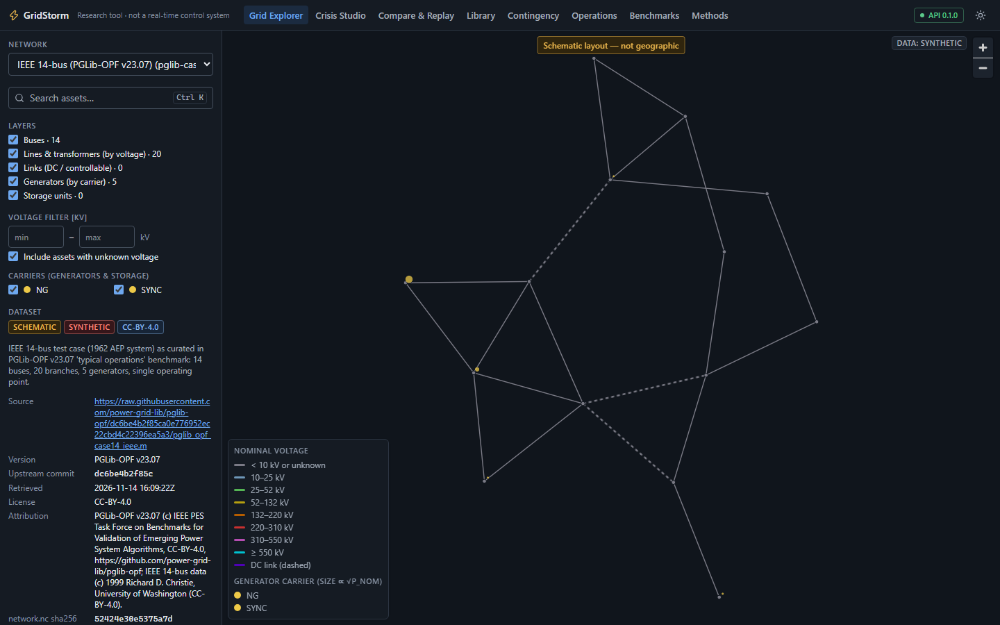

# GridStorm

Open-source power-grid resilience and crisis-simulation research platform.

- **Live app:** https://gridstorm.vercel.app
- **Live API:** https://gridstorm-api.onrender.com ([OpenAPI docs](https://gridstorm-api.onrender.com/docs)). It runs on Render's free tier, so after idling it takes about 30 s to wake.
- **Progress tracker with evidence:** [`TODO.md`](TODO.md)

> **GridStorm is a research and teaching tool.** It is not a live utility control system and not a
> validated real-world blackout predictor. Every number shown is labelled
> `observed | estimated | synthetic | modeled | calculated`.

## What you can do

1. **Explore a documented network.** There are five datasets, each with a checksummed manifest and licence: PyPSA `ac-dc-meshed`, SciGRID Germany `scigrid-de`, PGLib-OPF IEEE 14- and 118-bus, and a reduced PyPSA-Eur Belgium model (`pypsa-eur-be`, ODbL-1.0, with modelled CC-BY demand). Explore them on a MapLibre map, or on a labelled schematic layout where the data has no coordinates.
2. **Build a crisis in Crisis Studio.** Crisis events are line, transformer, link or generator outages, demand multipliers and renewable availability shortfalls. Mitigation options are storage dispatch, curtailment and priced load shedding. The scenario is written as a typed StormSpec scenario: JSON-Schema validated and hashed. Operations an engine cannot represent are rejected, never silently approximated.
3. **Run a real solve.** PyPSA linear optimal power flow solves the scenario with HiGHS in a subprocess with a timeout and an RSS memory watchdog. The job shows its real stages, with no fake percentages. Networks too large for the free instance (`scigrid-de`, about 550 MiB peak) return clearly labelled precomputed results instead.
4. **Inspect results.** The run dashboard shows unserved energy (Σ shed·Δt), cost, curtailment, CO₂, line loading on the map with a replay slider, storage, and solver termination.
5. **Compare** baseline vs crisis vs mitigation and export a reproducible Markdown/JSON report. The report embeds the scenario hashes, dataset SHA-256 and engine/solver versions.
6. **Research pages** show precomputed, reproducible studies, listed in the next table.

## Scientific components (all results measured, see linked docs)

| Component | What it does | Evidence |
|---|---|---|
| `packages/stormspec` | Typed crisis-scenario spec, hashing, engine capabilities, validation, manifests | [contracts](docs/architecture/contracts.md) |
| `workers/pypsa` | StormSpec → PyPSA LOPF adapter, 12 solved presets | [scientific spec](docs/architecture/scientific-spec.md) |
| `workers/pandapower` | AC power flow: 13 reference comparisons passed; N-1/N-2 with explicit outcome classes (secure, thermal overload, voltage violation, islanding, non-convergent, error) | [AC validation](docs/research/ac-validation.md) |
| `workers/advisor` | Deterministic Crisis Response Advisor; candidates accepted only after AC re-solve | [advisor](docs/research/crisis-advisor.md) |
| `packages/stormbench` | PTDF/LODF contingency screening vs exact DC/AC N-1 on 6 PGLib cases | [StormBench](docs/benchmarks/stormbench.md) |
| `tests/cross_engine` | PyPSA vs pandapower DC flows agree to ≤ 2.6e-12 MW | [cross-engine](docs/benchmarks/cross-engine.md) |
| `packages/stormrisk` | Monte Carlo outage sampling → EENS with 95 % CI, LOLP | [probabilistic stress](docs/research/probabilistic-stress.md) |
| `workers/grid2op` | Sequential operation, 3 agents × 2 chronics, deterministic traces | [Grid2Op](docs/research/grid2op-integration.md) |
| `workers/distribution` | SimBench LV AC time-series: PV over-voltage, curtailment, Q(U) | [SimBench](docs/research/simbench-distribution.md) |
| `pipelines/observed` | Historical-analogue stress scenarios on SciGRID-DE from the open ENTSO-E day-ahead load forecast (CC BY 4.0) | [observed analogues](docs/research/observed-analogue-scenarios.md) |
| `pipelines/pypsa-eur` | Reproducible reduced PyPSA-Eur Belgium build, published with licence-compliant synthetic demand | [build report](docs/research/pypsa-eur-build.md) · [licensing](docs/research/pypsa-eur-be-licensing.md) |
| `services/analytics` | PyPSA-Explorer analytics port (MIT, attributed) | [baseline audit](docs/audit/pypsa-explorer-baseline.md) |

## Architecture

React + TypeScript + MapLibre + ECharts on Vercel → FastAPI on Render, which runs PyPSA/HiGHS jobs as
subprocesses → Postgres (Supabase, with RLS) or a SQLite fallback. pandapower, Grid2Op, StormBench and
other studies run in **separate locked environments**, because their released dependency sets conflict
with PyPSA 1.4 (see [compatibility matrix](docs/research/compatibility-matrix.md)). They exchange
results through versioned, checksummed artifacts.
Details: [overview](docs/architecture/overview.md) · [decisions](docs/decisions/) ·
[engineering story](docs/engineering-story.md) · [user guide](docs/user-guide.md).

## Known limitations

- Jobs and metadata persist in **Supabase Postgres** and generated result files in a private **Supabase Storage** bucket (durable across Render restarts; verified by a controlled restart on 2026-11-15, see [TODO](TODO.md) POST-01). Results produced before that fix (issue #8) may return HTTP 410 `artifact_unavailable` and can be recomputed as a new job.
- Money values are in each dataset's declared **cost basis**, not universally EUR: PGLib cases use benchmark cost units (MATPOWER/PGLib nominal $, secant-linearised, not converted), the PyPSA example networks (`ac-dc-meshed`, `scigrid-de`) use illustrative placeholder cost units, and only the PyPSA-Eur Belgium model carries EUR-denominated model cost assumptions (technology-data v0.15.0, 2025 EUR). Value of lost load is a penalty in the same unit. Cross-basis cost comparisons are withheld. See the [cost-basis audit](docs/research/cost-basis-audit.md).
- LOPF is a DC linearisation: no reactive power, voltage magnitudes or losses. The AC studies are steady-state only: no protection, dynamics or transient stability.
- Outage probabilities in StormRisk are modelled from IEEE RTS-96 ranges, not observed for these networks.

## Development

See [`docs/deployment/local-development.md`](docs/deployment/local-development.md). Each Python
component has its own `uv` project (`uv sync && uv run pytest`). The web app: `cd apps/web && npm ci && npm run dev`.

## License

MIT (see [`LICENSE`](LICENSE)). Third-party code and data keep their own licences:
[`THIRD_PARTY_NOTICES.md`](THIRD_PARTY_NOTICES.md), [`UPSTREAM_ATTRIBUTION.md`](UPSTREAM_ATTRIBUTION.md),
[licence audit](docs/research/license-audit.md).
