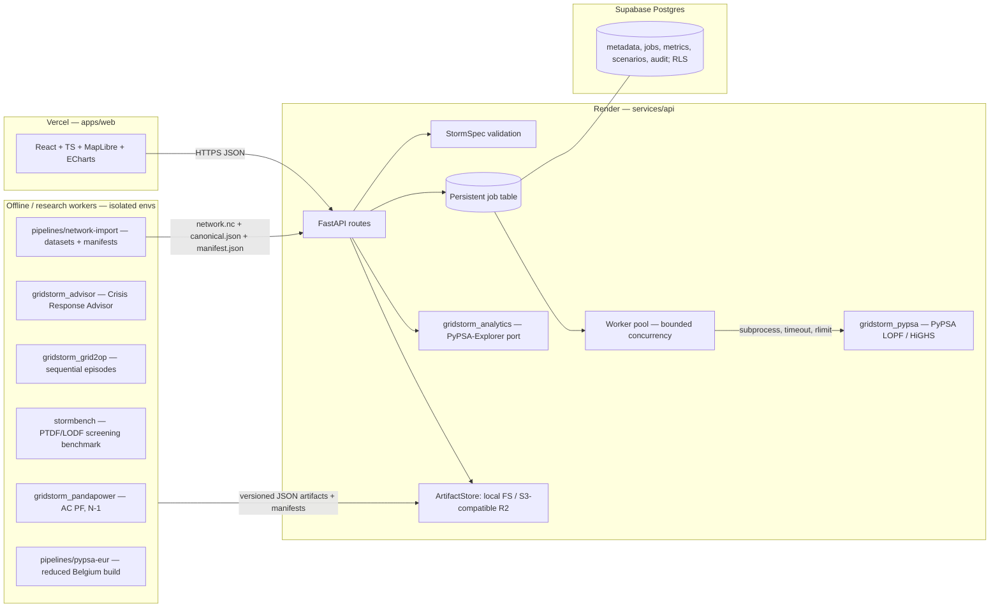

# GridStorm architecture overview

GridStorm is a power-grid resilience and crisis-simulation research platform. It wraps mature,
peer-reviewed open-source engines behind a typed scenario language (StormSpec), a job-oriented API
and a map-first web client. It is a research and teaching tool — **not** a live utility control
system and **not** a validated real-world blackout predictor.

## Principles

1. **Reuse engines, do not re-implement them.** PyPSA (linear OPF, storage, multi-period),
   pandapower (AC power flow, N-1), Grid2Op (sequential operation). GridStorm's original code is the
   scenario language, adapters, validation, benchmarks, provenance, API and UX.
2. **Isolated scientific environments.** Released manifests conflict (PyPSA 1.4 → pandas 3;
   pandapower 3.5 / Grid2Op 1.12 → pandas < 3). Each engine has its own locked `uv` environment.
   Engines exchange only versioned artifacts (`docs/architecture/contracts.md`).
3. **Honest outputs.** Every number is labelled `observed | estimated | synthetic | modeled |
   calculated`. Infeasible or failed runs are reported as such with diagnostics. Unsupported scenario
   operations are rejected, never silently approximated. Precomputed results are labelled.
4. **Reproducibility.** Scenarios are hashed (canonical JSON → SHA-256), datasets carry checksummed
   manifests, every run embeds an execution manifest (engine, solver, versions, options, platform).
5. **Two execution modes.** *Demo mode*: small networks solved live within strict CPU/memory/time
   limits, plus labelled precomputed results. *Research mode*: heavier studies run offline
   (local/provisioned workers) and published as artifacts.

## Components

| Path | Role | Env |
|---|---|---|
| `apps/web` | React control-room UI (Vercel) | Node |
| `services/api` | FastAPI, jobs, persistence, artifacts (Render) | core |
| `services/analytics` | PyPSA-Explorer analytics port | core |
| `packages/stormspec` | Scenario spec, hashing, capabilities, validation, manifests | pydantic only |
| `packages/canonical-grid` | Canonical network + dataset manifest schemas | pydantic only |
| `packages/stormbench` | Contingency screening benchmark | stormbench |
| `workers/pypsa` | StormSpec → PyPSA LOPF adapter | core |
| `workers/pandapower` | AC PF validation + N-1 | pandapower |
| `workers/advisor` | Deterministic Crisis Response Advisor | advisor |
| `workers/grid2op` | Sequential episodes + KPIs | grid2op |
| `pipelines/network-import` | Dataset importers + validation | pipelines |
| `pipelines/pypsa-eur` | Reduced PyPSA-Eur Belgium build | pypsa-eur (pixi) |
| `database/migrations` | Supabase SQL migrations + RLS | — |
| `data/networks`, `data/artifacts` | Small, licensed, checksummed datasets and results | — |

Interface details: [`contracts.md`](contracts.md). Decisions: [`../decisions/`](../decisions/).
