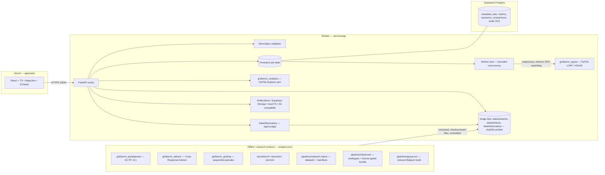

# GridStorm architecture overview

GridStorm is a power-grid resilience and crisis-simulation research platform. It wraps mature,
peer-reviewed open-source engines behind a typed scenario language (StormSpec), a job-oriented API
and a map-first web client, and publishes the open data it uses through a Data Observatory. It is a
research and teaching tool — **not** a live utility control system and **not** a validated
real-world blackout predictor.

## Principles

1. **Reuse engines, do not re-implement them.** PyPSA (linear OPF, storage, multi-period),
   pandapower (AC power flow, N-1), Grid2Op (sequential operation). GridStorm's original code is the
   scenario language, adapters, validation, benchmarks, provenance, data publication, API and UX.
2. **Isolated scientific environments.** Released manifests conflict (PyPSA 1.4 → pandas 3;
   pandapower 3.5 / Grid2Op 1.12 → pandas < 3). Each engine has its own locked `uv` environment.
   Engines exchange only versioned artifacts (`docs/architecture/contracts.md`).
3. **Honest outputs.** Every number is labelled `observed | estimated | synthetic | modeled |
   calculated`. Infeasible or failed runs are reported as such with diagnostics. Unsupported scenario
   operations are rejected, never silently approximated. Precomputed results are labelled.
   Missing data stays missing (never 0).
4. **Reproducibility.** Scenarios are hashed (canonical JSON → SHA-256), datasets carry
   checksummed manifests, every run embeds an execution manifest (engine, solver, versions, options,
   platform). `scientific.yml` regenerates reference artifacts weekly on a fresh runner and compares
   them with the committed files.
5. **Two execution modes.** *Demo mode*: small networks solved live within strict CPU/memory/time
   limits, plus labelled precomputed results. *Research mode*: heavier studies run offline
   (local/provisioned workers) and published as artifacts.

## File-backed reference data

Three kinds of read-only reference data are committed files baked into the API image, not SQL rows:

| Directory | Content | Integrity |
|---|---|---|
| `data/networks/` | Network models (`network.nc`, `canonical.json`, `manifest.json`), listed in `catalog.json` | manifest SHA-256 |
| `data/artifacts/<engine>/` | Precomputed research results, one `index.json` per engine | `payload_sha256` per artifact |
| `data/observatory/` | Data Observatory bundle: `catalog.json`, `series/<id>.csv`, `manifest.json` | every file sha256-verified at first load |

Supabase Postgres holds only mutable state (jobs, scenarios, comparisons, audit); Supabase Storage
holds generated result payloads. Rationale and the conditions under which the catalog would move to
SQL: [ADR 0003](../decisions/0003-file-backed-data-observatory.md).

## Data Observatory

`/data` in the web app and `GET /api/v1/data/catalog…` in the API present one catalog merged at
runtime from the bundle (observed/modeled/derived series and scenario metadata), one `network_model`
entry per network and one `precomputed_experiment` entry per study group. The bundle is produced by
`pipelines/observed` (`scripts/publish_observatory.py`), whose **licence gate** publishes only series
whose source licence permits redistribution; `--verify` re-checks checksums, schema, licence records
and a byte-identical rebuild. `observatory.yml` runs that check in CI, and Render's build filter
includes `data/observatory/**`, so publishing a bundle is a reviewed merge that redeploys the API.
Series are bounded (3 years, ≤ 2 000 points), UTC, gap-preserving; CSV export is refused for
non-redistributable entries. Routes and errors: [backend.md](backend.md#data-observatory-catalog-apiv1data);
pipeline: [observatory-pipeline.md](../data/observatory-pipeline.md); sources:
[sources-and-licensing.md](../data/sources-and-licensing.md).

## Components

| Path | Role | Env |
|---|---|---|
| `apps/web` | React control-room UI (Vercel) | Node |
| `services/api` | FastAPI, jobs, persistence, artifacts, Data Observatory catalog (Render) | core |
| `services/analytics` | PyPSA-Explorer analytics port | core |
| `packages/stormspec` | Scenario spec, hashing, capabilities, validation, manifests, presets | pydantic only |
| `packages/canonical-grid` | Canonical network + dataset manifest schemas | pydantic only |
| `packages/stormbench` | Contingency screening benchmark (tie-aware rank statistics) | stormbench |
| `packages/stormrisk` | Monte Carlo outage sampling, EENS / LOLP | stormrisk |
| `packages/stormml` | ML contingency screening research | stormml |
| `workers/pypsa` | StormSpec → PyPSA LOPF adapter | core |
| `workers/pandapower` | AC PF validation + N-1 | pandapower |
| `workers/advisor` | Deterministic Crisis Response Advisor | advisor |
| `workers/grid2op` | Sequential episodes + KPIs | grid2op |
| `workers/distribution` | SimBench LV AC time-series studies | distribution |
| `pipelines/network-import` | Dataset importers + validation | pipelines |
| `pipelines/observed` | Observed-analogue scenarios; licence-gated Data Observatory bundle | observed |
| `pipelines/pypsa-eur` | Reduced PyPSA-Eur Belgium build (upstream workflow) + dataset checks | pypsa-eur |
| `database/migrations` | Supabase SQL migrations + RLS | — |
| `data/networks`, `data/artifacts`, `data/observatory` | Small, licensed, checksummed datasets, results and observatory bundle | — |

Interface details: [`contracts.md`](contracts.md). Decisions: [`../decisions/`](../decisions/).
